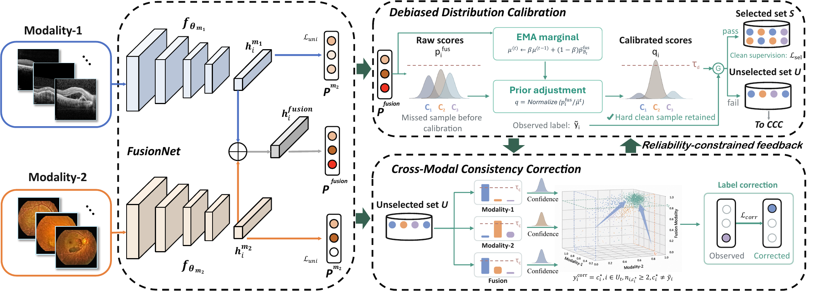

# De3C
This paper is submitted to MedIA.
# De<sup>3</sup>C: Debiased Cross-Modal Consistency Correction with Reliability-Aware Collaboration for Multimodal Medical Noisy-Label Learning

<p align="center">
  
  
  
  
  
</p>

---

## News

- **[2026.11]** MM-ECG implementation of **De<sup>3</sup>C** prepared for release.

---

## Overview

This repository provides the MM-ECG implementation of:

> **De<sup>3</sup>C: Debiased Cross-Modal Consistency Correction with Reliability-Aware Collaboration for Multimodal Medical Noisy-Label Learning**

De<sup>3</sup>C is designed for robust multimodal medical diagnosis under noisy annotations. Rather than treating sample selection and label correction as isolated processes, our framework establishes reliability-aware collaboration between them to preserve informative supervision and progressively refine noisy labels.

The main contributions include:

- **Debiased Distribution Calibration (DDC):** mitigates class-dependent selection bias through distribution calibration and complementary modality-specific evidence.
- **Cross-Modal Consistency Correction (CCC):** recovers informative supervision from unselected samples using high-confidence agreement between modality-specific and fused predictions, with reliability-weighted correction.
- **Reliability-constrained Feedback Mechanism (RFM):** incorporates highly confident and temporally stable correction evidence into subsequent sample selection.
- **Robust Multimodal Noisy-Label Learning:** supports different label noise rates and module-level ablations.

---

## Framework

<p align="center">
  
</p>

The overall framework contains two key modules and a collaborative feedback mechanism:

1. **Debiased Distribution Calibration**
   - Tracks class-wise prediction statistics through an exponential moving average (EMA).
   - Calibrates fused predictions and incorporates modality-specific counter-evidence to identify reliable observed labels.
2. **Cross-Modal Consistency Correction**
   - Exploits high-confidence agreement between any two of the three prediction branches.
   - Refines potentially corrupted labels and weights correction supervision according to predictive reliability.
3. **Reliability-constrained Feedback**
   - Collects stable, high-confidence correction evidence.
   - Refines the distribution used for subsequent sample selection.

---

## Datasets

We evaluate De<sup>3</sup>C on three multimodal medical datasets:

| Dataset | Task | Modalities | Link |
|---|---|---|---|
| MMC-AMD | AMD grading | Fundus + OCT | [Dataset](https://github.com/li-xirong/mmc-amd) |
| Harvard30k-AMD | AMD grading | SLO fundus + OCT | [Dataset](https://yutianyt.com/projects/fairvision30k/) |
| MM-ECG | Cardiac rhythm classification | 1D ECG + 2D ECG image | [MIMIC-IV-ECG](https://physionet.org/content/mimic-iv-ecg/1.0/) / [ECGInstruct](https://huggingface.co/datasets/PULSE-ECG/ECGInstruct) |

> We provide **MM-ECG** as the example implementation for reproduction and evaluation. The ophthalmic datasets are listed for reference; their training entry points are not included.

MM-ECG uses paired ECG signals and images for three-class classification (atrial fibrillation, sinus bradycardia, and sinus tachycardia). The original patient-disjoint split contains 7,035 training pairs and 1,759 testing pairs. Synthetic noise is applied only to training labels.

Prepare the paired NumPy arrays and metadata in the following format:

```text
data/MM-ECG/
├── final_report_with_mapping_with_ecg_new.csv
├── image_npy/
│   └── <sample>.npy
└── ecg_npy/
    └── <sample>.npy
```

The CSV requires `id`, `image`, `answer_text_mapped` (A/B/C), and `ecg_npy_new` (or `ecg_path`). It must also contain patient identifiers (`patient_id` or `subject_id`, or a recognizable patient ID in the source paths). The loader resolves array filenames and resizes images to 224 × 224; ECG arrays must represent 12 leads × 1,000 time points. The patient-level split is generated with seed 42 and exported to `splits/` under the data root.

See [DATA.md](DATA.md) for the exact input contract. The source links above do not contain the preprocessed MM-ECG subset in this exact layout. Obtain authorized access and prepare the paired subset before training; no medical data or patient manifests are redistributed here.

---

## Requirements

The target environment is Python 3.8 and PyTorch 1.13.0. Install the dependencies with:

```bash
pip install -r requirements.txt
```

For GPU training, install the appropriate CUDA-compatible PyTorch build for your system. The requirements file describes the target environment, not a verified lockfile for the original machine.

---

## Quick Start

A data-free forward/backward check of all three training stages:

```bash
python train_dec3_ecg_resnet1d_resnet50_ccc_vote.py --smoke-test --device cpu
```

Check your prepared dataset:

```bash
python dataloader_ECG.py --data-root data/MM-ECG
```

---

## Usage

Run the main training program with the complete De<sup>3</sup>C framework:

```bash
python train_dec3_ecg_resnet1d_resnet50_ccc_vote.py \
  --data-root data/MM-ECG --variant full --noise-rate 0.3 --gpu 0
```

Set `--noise-rate` to `0.4` or `0.5` for other noise levels. To run all three noise rates sequentially:

```bash
bash run_ecg.sh --data-root data/MM-ECG --gpu 0
```

The original MM-ECG experiment configuration uses 200 epochs, batch size 32, seed 42, DDC threshold 0.6, CCC threshold 0.8, a three-epoch warm-up and CCC starting at epoch 25 (zero-indexed). The image encoder learning rate is 1e-6; the ECG encoder and classifier learning rates are 1e-4. See [REPRODUCIBILITY.md](REPRODUCIBILITY.md) for details and known differences from the manuscript description.

Module-level ablations are supported via `--variant`:

| Variant | Description |
|---|---|
| `full` | Complete De<sup>3</sup>C |
| `no_ddc` | Without DDC and its dependent feedback |
| `no_ccc` | Without CCC and its dependent feedback |
| `no_feedback` | Without reliability-constrained feedback |
| `no_reliability` | Without the additional reliability mechanisms; retains original DDC and CCC |

Use `--help` for adjustable thresholds, loss coefficients, learning rates, and reliability parameters. Training saves logs, evaluation metrics, diagnostic statistics and final model weights in the generated run directory.

---

## Acknowledgement and Contact

We thank the authors of MMC-AMD, Harvard-FairVision, MIMIC-IV-ECG, ECGInstruct and ResNet for their valuable contributions to the research community.

For any questions, feel free to contact: [Jing.Li2@liverpool.ac.uk](mailto:Jing.Li2@liverpool.ac.uk).

This implementation is intended for research use, not clinical deployment.
